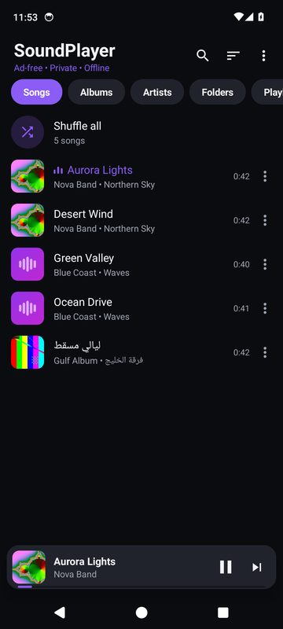
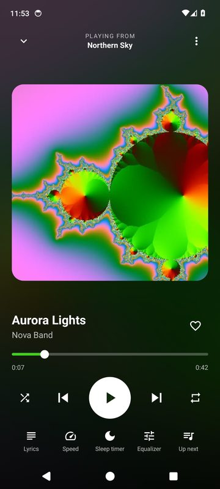
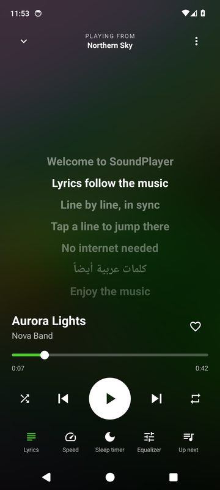
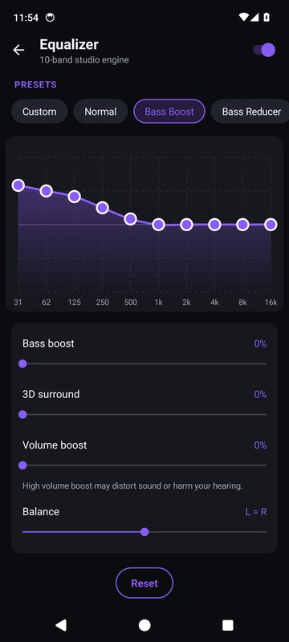
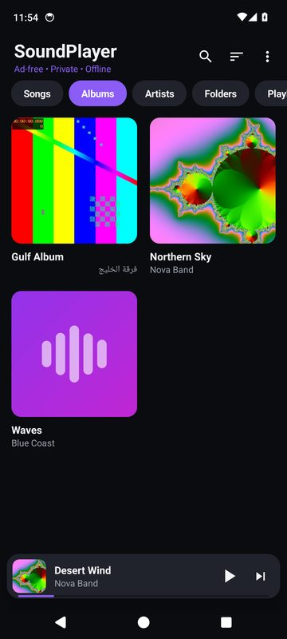
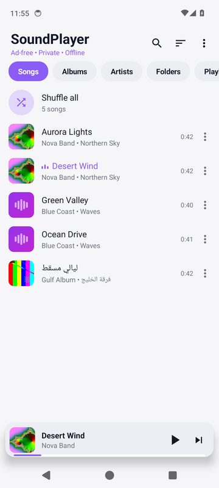

# SoundPlayer 🎵

A fast, beautiful, **100% offline** music player for Android — inspired by Lark Player, but with
**no ads, no tracking, no accounts and no internet permission at all**. The whole app is ~230 KB.

<p>
 
 
 
</p>

## Why it's better than Lark Player

| | SoundPlayer | Lark Player |
|---|---|---|
| Ads | **None** | Banner, interstitial & video ads |
| Internet permission / trackers | **None** – nothing can leave your phone | Yes |
| App size | **~0.23 MB** | ~40 MB+ |
| Equalizer | **True 10-band** (Android 9+) + 22 presets, bass boost, 3D surround, volume boost, L/R balance | 10-band |
| Synced lyrics | **Embedded tags (MP3, FLAC, OGG, M4A) + `.lrc`, tap a line to seek**, offline | Online search |
| Gapless playback & smooth fades | ✅ | ❌ |
| Arabic-aware search (أ/ا, ة/ه, harakat) | ✅ | ❌ |

## Features
- **Library**: Songs, Albums, Artists, Folders, Playlists – sorting, fast scroll, swipe between tabs
- **Playback**: background playback, notification & lock-screen controls, headset/Bluetooth/car buttons,
  gapless, fade in/out, shuffle & repeat, queue with drag-to-reorder, playback speed & pitch, resume where you left off
- **Now Playing**: blurred artwork background with colors taken from the album art, swipe the cover to skip,
  double-tap to like, swipe down to close
- **Lyrics**: synced (karaoke-style) and plain lyrics from tags or `.lrc` files; import or paste your own
- **Equalizer**: 10-band studio EQ with soft limiter, 22 presets (incl. *Arabic / Oud*), bass, 3D, loudness, balance
- **Playlists**: create/rename/delete, Favorites, Recently added/played, Most played, export to M3U
- **Extras**: sleep timer (incl. "end of song"), home-screen widget, app shortcuts, "Open with" for audio files,
  set as ringtone, share, song info (bitrate, sample rate…), delete, dark/light/system theme with 8 accent colors,
  hides short clips (voice notes, ringtones)
- Android 8.0 → 15+, edge-to-edge UI

## Download
Grab the APK from the [Releases](../../releases) page and install it (allow "Install unknown apps").

## Build
**Android Studio / Gradle:** open the project and run, or `./gradlew assembleDebug`.

**Without the Android SDK** (Debian/Ubuntu tools only):
```bash
sudo apt install aapt dalvik-exchange zipalign apksigner openjdk-17-jdk
ANDROID_JAR=/path/to/android-34.jar ./build.sh
```

## Tests
- JVM unit tests (queue/shuffle logic, LRC and ID3/FLAC/Ogg/MP4 lyric parsers, EQ math, Arabic search): `./gradlew test`
- Every push runs the app on Android 11 and 14 emulators in GitHub Actions (`ci/emulator-test.sh`): it plays music,
  checks media-session state, media keys, lyrics, every screen, and fails on any crash. Screenshots are pushed to the
  `ci-results` branch.

## Tech
Fully translated to Arabic (العربية) with right-to-left layout.

Pure Java on the Android framework – zero third-party libraries: `MediaPlayer` (gapless via `setNextMediaPlayer`),
`MediaSession`, `DynamicsProcessing`/`Equalizer`, `MediaStore`. MIT licensed.
